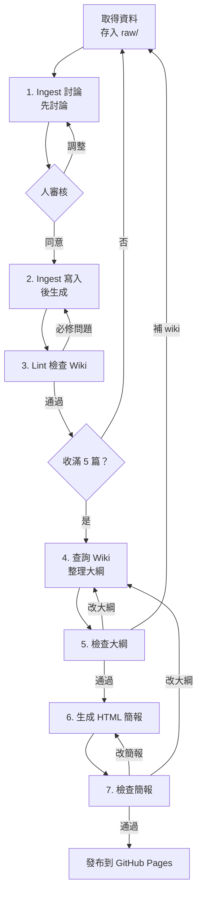

# Loop / Graph 設計

## 流程圖

簡化版：**取得資料 → 討論 → 寫入 Wiki → 檢查 Wiki →（重複 5 次）→ 查詢 Wiki → 整理大綱 → 檢查大綱 → 產生簡報 → 檢查簡報 → 發布**

## 哪些步驟會重複執行？

| 迴圈 | 範圍 | 結束條件 |
|---|---|---|
| Ingest 迴圈 | 取得 → 討論 → 寫入 → lint | 收滿 5 篇，且 lint 沒有必修問題 |
| 討論迴圈 | 討論 ↔ 人審核 | 人同意要收的內容 |
| Lint 迴圈 | 寫入 ↔ lint | 沒有必修問題 |
| 大綱迴圈 | 整理大綱 ↔ 檢查大綱 | 每個重點都能追溯到 wiki |
| 簡報迴圈 | 生成 ↔ 檢查簡報 | 沒有新增事實、版面正常 |

## 哪些地方需要檢查或重新生成？

- **人審核（節點 1 之後）**：決定哪些內容值得收，防止 AI 把無關或錯誤的內容寫進 wiki。
- **Lint（節點 3）**：檢查來源標註、連結與矛盾。
- **檢查大綱（節點 5）**：確認每個重點都能追溯到 wiki；wiki 缺資料時回頭補 ingest。
- **檢查簡報（節點 7）**：確認簡報沒有加入大綱以外的事實，並實際打開瀏覽器看版面。

## 為什麼這樣設計？

1. **越早檢查，重做越便宜。** wiki 寫錯，影響的是後面所有的大綱與簡報。在 ingest 當下就 lint，修一頁就好。
2. **讓每個事實都能追溯。** 從 raw → wiki → 大綱 → 簡報，每一層都標註上一層的來源，檢查時可以一路往回對。
3. **分開「內容正確」和「呈現好看」。** 大綱負責內容，簡報只負責呈現，生成簡報時不准新增事實，錯誤就不會在最後一步混進來。
4. **人只在需要判斷的地方介入。** 決定收什麼、要不要放行，由人決定；整理、格式、比對交給 AI。

> 實際執行後如果修改了流程，把修改前後的差異寫在 `reflection.md`，並更新這張圖。
